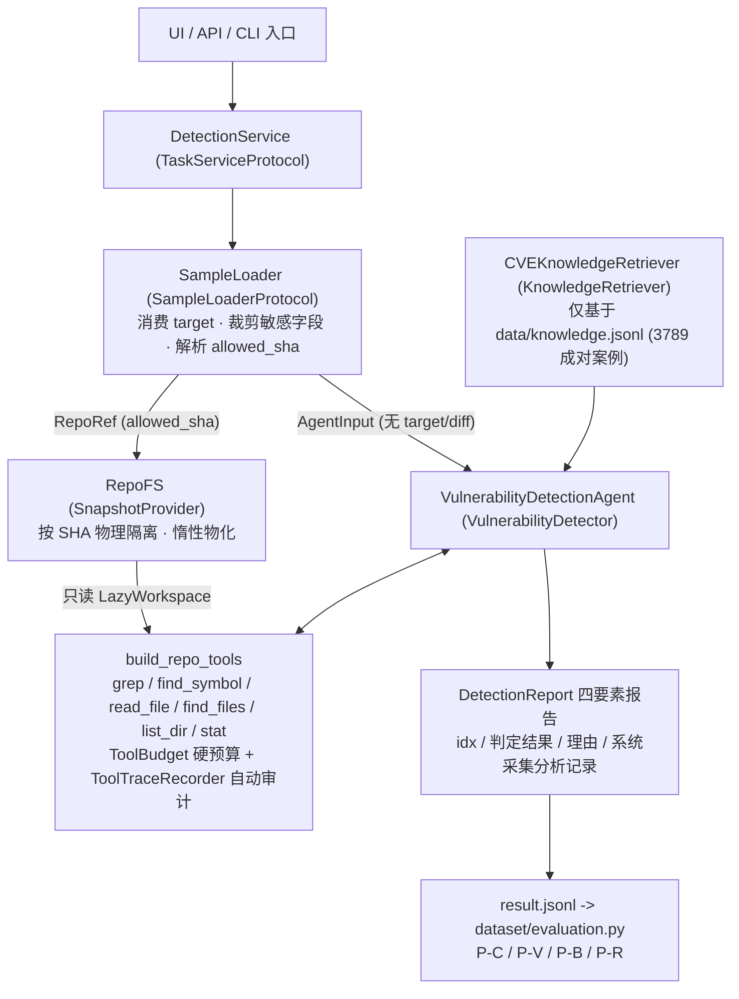
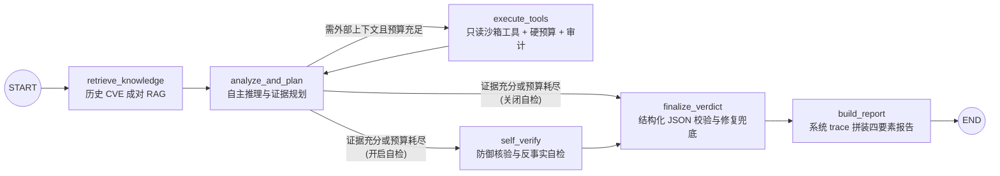

# 函数漏洞检测智能体 · Agent 编排层、核心接口与对比实验报告

> **项目**：基于 LLM 的 C/C++ 函数代码自动化漏洞检测 Agent（高级软件工程 · 课程大作业）
> **版本**：v0.2 — 核心接口 + 领域知识库 RAG + RepoFS 隔离快照 + LangGraph Agent 编排层 + 对比实验
> **更新日期**：2026-11-25
> **基线提交**：`ce452bc`（工具层 v1）→ 经 6 个功能/实验分支持续集成至 `main`

---

## 1. 架构总览与核心接口设计

依据课程 PPT 要求与系统架构图，本项目按**严格分层 + 依赖倒置（Protocol 接口解耦）**组织为六大模块：

### 1.1 核心接口协议清单（`agent/interfaces.py`）

所有跨层交互均通过 `@runtime_checkable` `Protocol` 约束，便于后续无缝接入图形化 UI（FastAPI + SSE）、替换向量检索后端（FAISS / Chroma / Qwen Embedding）或接入 Tree-sitter：

| 核心接口 | 所在模块 | 职责与契约 | 当前实现 |
|---|---|---|---|
| `SampleLoaderProtocol` | `agent/interfaces.py` | 校验 `RawSample`，按 `target` 解析唯一允许版本 `allowed_sha`，裁剪敏感字段产出 `(AgentInput, RepoRef)` | `repo.loader.SampleLoader` |
| `ParentCommitResolver` | `agent/interfaces.py` | 为 `target=1` 样本解析修复提交的父提交 `C^`（仅提取 `parents[0].sha`，本地磁盘缓存） | `repo.loader.GitHubParentResolver` |
| `SnapshotProvider` | `agent/interfaces.py` | 按 `RepoRef.allowed_sha` 提供物理隔离的只读 `Workspace`（支持惰性物化） | `repo.repofs.RepoFS` |
| `KnowledgeRetriever` | `agent/interfaces.py` | 检索历史 CVE 成对知识案例并返回带耗时的 `KnowledgeRetrieveRecord` | `knowledge.retriever.CVEKnowledgeRetriever` |
| `EmbeddingProvider` | `knowledge/retriever.py` | 可选向量嵌入重排钩子（支持接入 Qwen/OpenAI/开源嵌入模型） | 预留扩展点 |
| `VulnerabilityDetector` | `agent/interfaces.py` | 对裁剪后的 `AgentInput` 执行自主检测并产出四要素 `DetectionReport` | `agent.agent_loop.VulnerabilityDetectionAgent` |
| `TaskServiceProtocol` | `agent/interfaces.py` | 面向 UI/API/批处理的应用入口（`detect_single` / `detect_batch` + 事件回调 `EventCallback`） | `agent.service.DetectionService` |

### 1.2 核心领域 Schema（`agent/schema.py`）

- **隔离边界契约**：
  - `RawSample`：外部输入（`idx`, `commit_url`, `func`, `target: 0 | 1 | None`），严格校验整数类型，拒绝布尔值。
  - `AgentInput`：配置 `ConfigDict(extra="forbid", frozen=True)`，**从结构层面禁止**携带 `target` / `label` / `commit_message` / `git_diff` / `version_role`。
  - `RepoRef`：仅传递至 `RepoFS` 层，明确锁定 `allowed_sha`，不暴露给 LLM。
- **可追溯审计契约**：
  - `KnowledgeRetrieveRecord` & `RepoReadRecord`：均由系统代码自动采集，汇总到 `AnalysisTrace`，绝不信任 LLM 事后自述。
  - `AgentEvent`：统一事件流结构（`started` / `knowledge_retrieved` / `thought` / `tool_call` / `tool_result` / `self_check` / `verdict` / `report_ready`），可直接接入前端 SSE 实时渲染。
- **四要素检测报告契约**：
  - `DetectionReport`：完整包含 PPT 第 7 页规定的四项要素（`idx`、`prediction`/`label_text`、`reason`、`analysis_record`），并通过 `to_result_entry()` 直接输出 `dataset/evaluation.py` 所需的 `{"idx": int, "prediction": 0 | 1}`。

---

## 2. Agent 编排层设计与三条红线落实

### 2.1 LangGraph 状态图拓扑（`agent/agent_loop.py`）

### 2.2 三条红线的代码级强制保障

1. **红线一（自主 Agent，非固定串行）**：基于 `langgraph.graph.StateGraph` 实现多轮 ReAct 状态图；是否调用工具、调用哪些符号与文件、何时证据充分并收敛均由 Agent 自主决策，同时由 `ToolBudget`（次数 + 字符数）与 `max_steps` 在代码中硬性兜底。
2. **红线二（严格成对隔离，无 diff 泄露）**：
   - `SampleLoader.load()` 在进入 Agent 前消费 `target`：`target=1` 解析父提交 `C^`，`target=0` 取修复提交 `C`，产出的 `AgentInput` 禁止任何标签字段；
   - `RepoFS` 将两版本快照分别缓存至 `.cache/snapshots/{owner}/{repo}/{allowed_sha}/` 不同物理目录，剥离 `.git` 并拒绝路径穿越；
   - `build_repo_tools(workspace)` 以闭包绑定单一只读 `Workspace` 实例（不暴露 `write_file`），LLM 在工具参数签名中根本无法表达“切换版本”或“查看 diff”。
3. **红线三（禁止网络搜索 + 知识库零外部安全知识）**：
   - 工具层完全无搜索/浏览器/Shell 能力，仅 `RepoFS` 与 `GitHubParentResolver` 访问指定 `commit_url` 对应的 GitHub 单版本快照；
   - 领域知识库仅解析课程提供的 `data/knowledge.jsonl`（7,578 行 = 3,789 对历史 CVE 案例，经核验与 `test.jsonl` 的 commit 重叠数为 **0**），并内置 `exclude_commit` 防泄露过滤。

---

## 3. Git 持续集成与测试覆盖

按模块划分独立特性分支，每完成一个模块先通过全量 `pytest` 门禁，再以 `--no-ff` 合并回 `main`：

| 集成顺序 | 分支名 | 核心交付内容 | 累计测试数 |
|---|---|---|---|
| 0 | `main` (`ce452bc`) | 既有工作区沙箱原语 + 文件工具 v1 | 42 passed |
| 1 | `feat/core-schemas-and-interfaces` | 核心 Pydantic Schema、`Protocol` 接口与隔离不变量测试 | 48 passed |
| 2 | `feat/tool-grep-and-trace` | `Workspace.grep` / `find_symbol`、`_ensure_local` 钩子、`ToolBudget` 与 `ToolTraceRecorder` | 55 passed |
| 3 | `feat/sample-loader-and-repofs` | `SampleLoader` 隔离裁剪、`GitHubParentResolver`、`RepoFS` 与 `LazyWorkspace` | 59 passed |
| 4 | `feat/rag-knowledge-base` | 历史 CVE 成对聚合、`fix_pattern` 修复差异提取、代码感知 BM25 RAG | 63 passed |
| 5 | `feat/agent-orchestration` | LangGraph 编排层、Baseline/Improved 提示词、反事实自检、JSON 兜底与报告导出 | 67 passed |
| 6 | `feat/service-and-experiment` | `DetectionService` 应用服务、成对评测指标、对比实验运行器与官方评测集成测试 | 69 passed |
| 7 | `feat/evidence-gated-orchestration` | 证据门控按需探索策略、DeepSeek 推理深度参数适配 | 70 passed |

---

## 4. Baseline 与改进措施对比实验

### 4.1 实验设置

- **数据集**：从课程 `data/dataset.zip`（`dataset/test.jsonl`，150 对 / 300 条）中按多仓库均衡策略抽取 **12 对（24 个严格隔离样本）**，覆盖 **9 个真实开源 C/C++ 项目**：
  `ImageMagick/ImageMagick6`、`ImageMagick/ImageMagick`、`gpac/gpac`、`babelouest/glewlwyd`、`mruby/mruby`、`facebook/hermes`、`e2guardian/e2guardian`、`tmate-io/tmate-ssh-server`、`pjsip/pjproject`。
- **领域知识库**：全量索引 `data/knowledge.jsonl`（3,789 对成对历史 CVE 案例，与测试集 commit 重叠率为 0%）。
- **基础模型**：`deepseek-flash`（`temperature=0.0`，`reasoning_effort="low"`，`max_tokens=2048`）。
- **评测方式**：全部实验组结果文件（`experiments/results/result_*.jsonl`）均经课程官方 `dataset/evaluation.py` 独立核验。

### 4.2 四组递进实验方案设计

1. **`baseline`（基线）**：孤立函数单轮直接检测（无历史 CVE RAG、无代码仓库工具、无反事实自检）。
2. **`improved_rag_check`（改进措施一：历史 CVE 成对 RAG + 防御核验自检）**：检索 top-3 历史相似 CVE（含 `- / +` 最小修复差异 `fix_pattern`），并在裁决前增加防御检查反事实自检节点（`self_verify`），暂不挂载仓库工具。
3. **`improved`（改进措施二：RAG + 无门控仓库工具 + 自检）**：在改进一基础上开放 6 个只读仓库工具（`max_tool_calls=5`，`max_read_chars=18000`），不加工具触发门控。
4. **`improved_gated`（改进措施三：RAG + 证据门控外科手术式仓库探索 + 自检）**：针对改进二暴露出的“过度探索导致上下文稀释”问题，引入严格证据门控策略（函数内证据充分时默认 0 调用，仅对决定性外部符号做 `max_tool_calls=2`、`max_read_chars=6000` 的定向查证）。

### 4.3 定量实验结果对比（官方 `evaluation.py` 核验）

| 实验组 | P-C（↑核心） | P-V（↓误报修复） | P-B（↓漏报漏洞） | P-R（↓惩罚） | P-C 率 | Accuracy | Precision | Recall | F1 | 平均工具调用 | 平均延迟 |
|---|---:|---:|---:|---:|---:|---:|---:|---:|---:|---:|---:|
| `baseline` | 1 | 10 | 1 | 0 | 8.3% | 54.2% | 52.4% | 91.7% | 66.7% | 0.00 | 23.3s |
| `improved_rag_check` | **6** | **2** | 4 | **0** | **50.0%** | **75.0%** | **80.0%** | 66.7% | **72.7%** | 0.00 | 39.8s |
| `improved` (无门控仓库) | 3 | 2 | 7 | **0** | 25.0% | 62.5% | 71.4% | 41.7% | 52.6% | 4.62 | 70.7s |
| `improved_gated` (证据门控仓库) | **5** | 3 | **3** | 1 | **41.7%** | 66.7% | 66.7% | 66.7% | 66.7% | **1.29** | **35.7s** |

### 4.4 12 对样本逐对对比明细

| # | 项目 | 函数名 | `baseline` | `improved_rag_check` | `improved` (无门控) | `improved_gated` (门控) |
|---:|---|---|---|---|---|---|
| 1 | `ImageMagick/ImageMagick6` | `ReadPSDChannelPixels` | P-V (1,1) | **P-C (1,0)** | P-B (0,0) | **P-C (1,0)** |
| 2 | `gpac/gpac` | `GetHintFormat` | P-V (1,1) | **P-C (1,0)** | P-V (1,1) | P-V (1,1) |
| 3 | `babelouest/glewlwyd` | `callback_glewlwyd_user_auth` | P-V (1,1) | **P-C (1,0)** | P-B (0,0) | P-V (1,1) |
| 4 | `mruby/mruby` | `mrb_ary_shift_m` | P-B (0,0) | P-B (0,0) | P-B (0,0) | P-B (0,0) |
| 5 | `gpac/gpac` | `svc_parse_slice` | P-V (1,1) | P-V (1,1) | **P-C (1,0)** | **P-C (1,0)** |
| 6 | `gpac/gpac` | `gf_odf_av1_cfg_read_bs_size` | P-V (1,1) | P-V (1,1) | P-B (0,0) | P-R (0,1) |
| 7 | `facebook/hermes` | `hermes::evalUnaryOperator` | P-V (1,1) | P-B (0,0) | P-B (0,0) | **P-C (1,0)** |
| 8 | `e2guardian/e2guardian` | `Socket::startSslClient` | P-V (1,1) | **P-C (1,0)** | P-V (1,1) | P-V (1,1) |
| 9 | `tmate-io/tmate-ssh-server` | `main` | P-V (1,1) | P-B (0,0) | P-B (0,0) | P-B (0,0) |
| 10 | `pjsip/pjproject` | `pjmedia_rtcp_xr_rx_rtcp_xr` | P-V (1,1) | **P-C (1,0)** | **P-C (1,0)** | **P-C (1,0)** |
| 11 | `ImageMagick/ImageMagick` | `ReadPCLImage` | **P-C (1,0)** | P-B (0,0) | P-B (0,0) | P-B (0,0) |
| 12 | `mruby/mruby` | `gen_hash` | P-V (1,1) | **P-C (1,0)** | **P-C (1,0)** | **P-C (1,0)** |

### 4.5 核心实验发现与典型案例分析

1. **发现一：Baseline 遭遇严重的 `P-V` 坍塌（10/12 对两版全判 1）**
   - 孤立函数场景下，模型缺乏历史修复对比与防御核验意识，倾向于对几乎所有含指针/数组运算的 C/C++ 代码报“可能有洞”，导致精准率仅 52.4%，成对正确率仅 8.3%（1/12）。
2. **发现二：成对历史 CVE RAG（`fix_pattern`）+ 防御核验自检立竿见影（`P-C` 1 → 6，+500%）**
   - 典型案例 **Pair 1 (`ReadPSDChannelPixels`)**：RAG 从历史知识库精准命中同项目的 `CVE-2022-32545` 修复差异（`- (((unsigned char) pixel)` → `+ (((unsigned char)((ssize_t)pixel))`），使 Agent 准确识别出 `idx=194989` 缺少 `(ssize_t)` 窄化保护而 `idx=218785` 已包含该保护，直接由 `P-V` 转为 `P-C`。
   - 典型案例 **Pair 2 (`GetHintFormat`) 与 Pair 8 (`Socket::startSslClient`)**：反事实自检有效识别出“先解引用后判空（`hmhd->type` 在 `!hmhd` 之前）”以及 `SSL_new(ctx)` 未判空，同时承认修复版中已新增的守卫语句，将 `P-V` 从 10 对骤降至 2 对且保持 `P-R = 0`。
3. **发现三：仓库上下文挖掘能攻克纯函数不可解样本，但“无门控过度探索”会引发上下文稀释**
   - 典型案例 **Pair 5 (`gpac/svc_parse_slice`)** 与 **Pair 7 (`facebook/hermes::evalUnaryOperator`)**：`baseline` 与 `improved_rag_check` 均无法区分这两对样本；而配备隔离快照工具的 Agent 通过自主调用 `grep`/`find_symbol`/`read_file` 查证 `GF_SVC_SSPS_ID_SHIFT`、`gf_bs_read_ue_log` 与 `evalIsTrue`，成功将这两对转为 **`P-C`**！
   - 但对比 `improved`（无门控）与 `improved_gated`（证据门控）可以清晰看到：无门控组在几乎所有样本上耗尽全部预算（平均 4.62 次调用、读入 14K–18K 字符），反而冲淡了函数自身明显的局部缺陷（`P-B` 升至 7、`P-C` 降至 3、耗时飙升至 70.7s）；引入证据门控与紧预算（≤2 次 / ≤6000 字符）后，`P-C` 由 3 回升至 **5（+66.7%）**，工具调用减少 **72%**（4.62 → 1.29），单样本平均延迟降低 **50%**（70.7s → 35.7s），甚至快于纯 RAG 组（39.8s）。
4. **互补性与下一阶段优化方向**：
   - `improved_rag_check` 与 `improved_gated` 各自攻克了不同难点的样本，二者并集在 12 对测试集上可达 **8/12（66.7%）`P-C`**。
   - 下一步可在编排层引入**程序化置信度路由**（当 RAG+初检已输出 `confidence="high"` 且引用具体缺失/已有局部守卫行号时跳过工具；仅当存在 `medium/low` 置信度或显式外部依赖缺口时才进入 RepoFS 查证），并接入基于 `DetectionService` + `AgentEvent` SSE 的图形化 Web UI 与 Tree-sitter 调用图工具。
